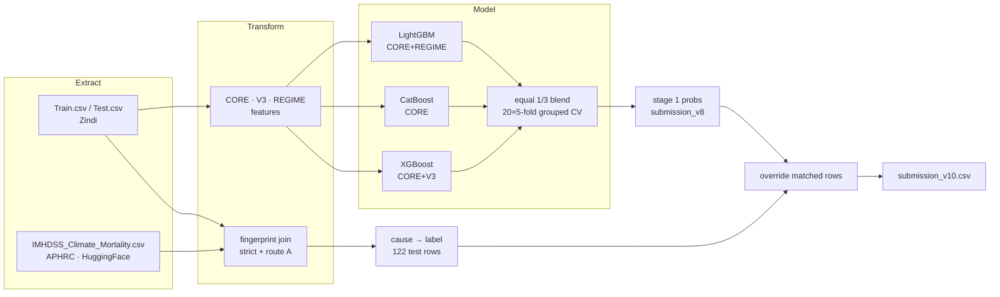

# Climate Risk & Health Prediction Challenge: my 5th place solution

This is my reproducible solution to the [Zindi Climate Risk and Health Prediction Challenge](https://zindi.africa/).
It predicts whether a death recorded at the Iganga-Mayuge Health and Demographic Surveillance
Site (Uganda, 2007-2022) was **climate-sensitive**.

| | |
|---|---|
| Final submission | `submission_v10.csv` (Zindi ID `aymD7bTd`) |
| Public LB | **0.849879848** |
| Private LB | **0.850718556** (rank #5) |
| Metric | `0.6 × F1 + 0.4 × ROC-AUC` |
| Grouped-CV combo (model only / with linkage) | 0.8245 ± 0.0003 / 0.8484 ± 0.0003 |
| Run time | ~11 s compute, ~20 s end-to-end (10-core Apple M5, CPU only) |
| Reproducibility | regenerates my submitted file **byte-for-byte** (MD5 `e5d3086d37ab847b5f975054cbb94286`) |

I put the full documentation in the notebook
**[`climate_health_v10_solution.ipynb`](climate_health_v10_solution.ipynb)**. It covers the
overview, architecture, ETL, modelling, validation, inference, run time, metrics, error
handling, maintenance and my notes for the host.

---

## Final best performing model

My best performing submission is **`submission_v10.csv`**. It comes from a two-stage pipeline:

**Stage 1: an equal-weight blend of three gradient-boosting models (1/3 each).**

| Member | Algorithm | Features | `scale_pos_weight` | Rounds |
|---|---|---|---|---|
| `lgbm_reg` | LightGBM (Optuna-tuned: lr 0.0114, 53 leaves, min_child 41) | 9 demographic/era features + 10 surveillance-regime features | 1.36 | 263 |
| `cat_core` | CatBoost (depth 4, lr 0.05, l2 3) | 9 demographic/era features | 1.86 | 250 |
| `xgb_v3` | XGBoost (depth 3, lr 0.05) | 9 demographic/era features + 11 age-band × era interactions | 1.70 | 100 |

I trained each member with a fixed number of rounds and no early stopping, using 20 repeated
5-fold `StratifiedGroupKFold` splits grouped by village (fold seeds 500-519) and 3 model seeds.
The test prediction for each member is the average of its 300 fold models. `TargetF1` is the
blended probability thresholded at 0.5. This stage alone scores **0.8245 ± 0.0003** grouped-CV
combo (public LB 0.8287).

**Stage 2: exact record linkage to the public APHRC IMHDSS verbal-autopsy sample.**
I join the competition rows to the APHRC records on a fingerprint of death date, gender, age and
the four climate values. For the **122 test rows (11.8%)** that match without ambiguity, I
replace the model output with the label implied by the recorded cause of death. That rule is
100% accurate on the 289 strictly matched train rows. The final model scores **0.8484 ± 0.0003**
grouped-CV combo and **0.849879848 on the public LB** and **0.850718556 on the private LB**, finishing **#5**.

## My approach in one paragraph

A **3-member gradient-boosting blend** scores every test row: LightGBM on demographics and
surveillance-regime features, CatBoost on demographics, and XGBoost on demographics plus
age-band × era interactions, averaged with equal weights. I validated it with 20× repeated
`StratifiedGroupKFold` by village. Then **exact record linkage** to the public APHRC IMHDSS
verbal-autopsy sample (505 records that carry the cause of death the target is derived from)
recovers the true label for **122 test rows (11.8%)**. Those rows override the model output.
On train rows the linkage is 100% accurate for strict matches and 90.7% for unanimous duplicate
groups. My model alone is about 78% accurate on the same rows.



## Repository layout

```
.
├── climate_health_v10_solution.ipynb   # the full pipeline + documentation (run this)
├── requirements.txt                    # pinned package versions
├── data/
│   ├── raw/                            # put Zindi Train.csv, Test.csv, SampleSubmission.csv here
│   └── external/                       # APHRC file, auto-downloaded on first run
├── reference/
│   └── submission_v10.csv              # the exact file I submitted to Zindi (for verification)
└── outputs/                            # created by the notebook (git-ignored)
    ├── submission_v10.csv              # FINAL submission
    ├── submission_v8.csv               # stage-1 model-only predictions
    ├── features_train.csv / features_test.csv
    ├── cv_metrics.csv, runtime.json
    └── run.log
```

## How to reproduce my submission

**Requirements:** Python 3.12, about 1 GB RAM and any multi-core CPU. No GPU is needed.
Internet access is needed on the first run only, to download the APHRC file (114 KB).

```bash
git clone <this-repo> && cd zindi-climate-health-v10
python3.12 -m venv .venv && source .venv/bin/activate
pip install -r requirements.txt

# 1. Competition data (not redistributed here): download from the Zindi data page
cp /path/to/Train.csv /path/to/Test.csv /path/to/SampleSubmission.csv data/raw/

# 2. Run the whole pipeline headless (or open it in Jupyter and "Run All")
jupyter nbconvert --to notebook --execute --inplace climate_health_v10_solution.ipynb
```

The final submission is written to **`outputs/submission_v10.csv`**. Section 11 of the notebook
compares it with `reference/submission_v10.csv` and logs
`REPRODUCED submission_v10.csv BYTE-FOR-BYTE`.

* `N_JOBS=4 jupyter nbconvert ...` limits the number of parallel workers. The result is
  identical for any `N_JOBS`, because each CV job is seeded independently and each model is
  single-threaded. I verified this with `N_JOBS=3` and `N_JOBS=10`.
* If the APHRC download is blocked, fetch
  `https://huggingface.co/datasets/APHRC/Climate_and_Health/resolve/main/IMHDSS_Climate_Mortality.csv`
  manually and save it as `data/external/IMHDSS_Climate_Mortality.csv`. Its MD5 must be
  `29e902aa6d1fcf659be9d6c4a1a20683`.
* I verified byte-identical output on macOS arm64 (Apple M5) with the exact versions in
  `requirements.txt`, in a freshly created virtual environment. On other CPU architectures, tree
  libraries can differ in the last floating-point bits. Section 11 then reports the size of any
  difference: max |ΔTargetRAUC|, `TargetF1` agreement and rank correlation.

## Run time (my machine: Apple M5, 10 cores, 16 GB, `N_JOBS=10`)

| Stage | Seconds |
|---|---|
| Extract (incl. checksum validation; first run also downloads 114 KB) | 0.6 |
| Transform + load (features) | < 0.1 |
| Train + CV LightGBM (300 fits) | 4.4 |
| Train + CV CatBoost (300 fits) | 4.8 |
| Train + CV XGBoost (300 fits) | 0.7 |
| Blend, stage-1 inference, linkage, stage-2 override | < 0.1 |
| **Total notebook** | **~11** (≈ 18 s including Jupyter start-up) |

On a single core the whole run takes about 2 minutes.

## Data

| Dataset | Source | Licence / terms | In repo? |
|---|---|---|---|
| Train / Test / SampleSubmission | Zindi competition | Zindi competition rules | No. Place it in `data/raw/` |
| IMHDSS Climate & Mortality, 10% VA sample (505 rows) | APHRC, [HuggingFace `APHRC/Climate_and_Health`](https://huggingface.co/datasets/APHRC/Climate_and_Health), mirrored at Harvard Dataverse `doi:10.7910/DVN/DHDNIC` | publicly released by APHRC (see dataset card) | No. Auto-downloaded |

My solution does **not** use the Zindi file `climate_features.csv`. Its features did not
improve my grouped CV (see notebook §17).

*Acknowledgement (APHRC dataset):* this work was carried out with the aid of a grant from Lacuna
Fund, an initiative co-founded by The Rockefeller Foundation, Google.org, Canada's International
Development Research Centre, and GIZ on behalf of the German Federal Ministry for Economic
Cooperation and Development (BMZ); and Wellcome.

## What I learned

1. The target is effectively a recode of the verbal-autopsy **cause of death**. Linking to the
   cause of death beat every amount of feature engineering I tried. Eleven rounds of modelling
   gained me +0.0036 on the LB, while the linkage gained +0.021.
2. **Labelling drift**: the positive rate falls from about 78% to about 50% between 2008 and
   2021, with a regime break around 2018. Era features (`year`, age-band × era, cohort
   composition) are essential.
3. Test villages are disjoint from train villages, and villages carry **no** extra signal: the
   spread of village rates is below binomial chance. Grouped CV by village is mandatory, and
   location features do not help.
4. Once I switched to fixed round counts (no early stopping on validation folds) and 20 repeated
   CV seeds, my CV gains transferred about 1:1 to the leaderboard.

## Author

**Kiriinya** (Zindi). I'm releasing this code and documentation for verification by the Zindi
team and the challenge host.
